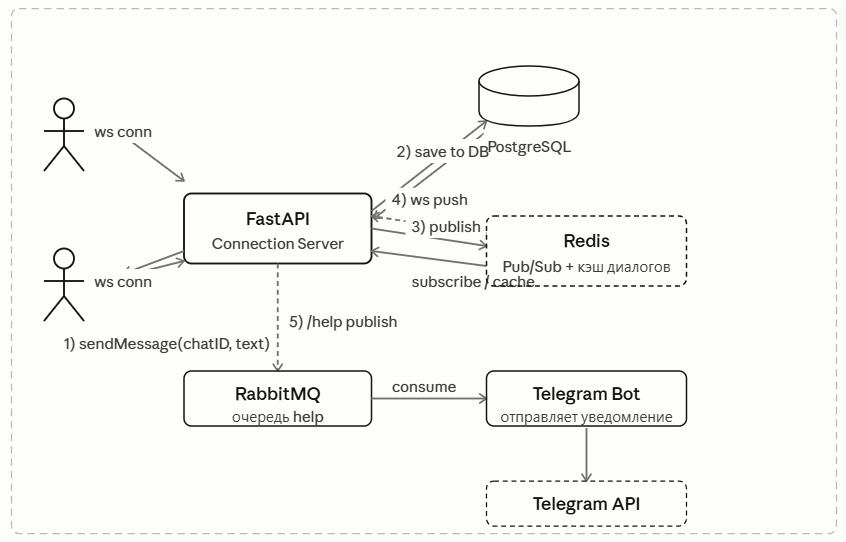

# Эмулятор мессенджера с регистрацией без привязки к данным + связь с телеграмм ботом

идея заключалась в создании +- анонимного мессенджера, в котором не нужно вводить ничего

## основной функционал на данный момент:
    - Регистрация и авторизация (JWT)
    - Личные беседы
    - Групповые беседы
    - Удаление диалога
    - Текстовые сообщения и ответ на сообщение (reply)
    - Вложения: фото, видео, документы (pdf, doc, docx)
    - Сообщения в реальном времени через WebSocket и Redis
    - Кэш списка диалогов в Redis
    - Обращение в поддержку: сообщение уходит в RabbitMQ, телеграм-бот пересылает его админу

## плюсы
    - анонимность
    - нет привязки к данным
    - защита от слежки
    - создание одноразовых аккаунтов
## минусы
    - невозможно сделать двухфакторную аутентификацию
    - невозможность восстановить аккаунт
    - пониженное доверие в переписке

## установка
    git clone https://github.com/levvis16/levi_app

    docker compose up --build

Приложение доступно на порту 8000. Интерфейс: `static/index.html`, стили в `static/css/app.css`, логика в `static/js/app.js`.

# Основной стек технологий:

### FastAPI, PostgreSQL, RabbitMQ, Redis, JWT-authentication, Alembic, SQLAlchemy, Pydantic, Uvicorn, asyncpg, bcrypt, aiogram

## планы на будущее:
    - расширение возможностей админа (сейчас админ может только удалять пользователя)
    - отображать, онлайн ли пользователь
    - удаление отдельного сообщения
    - удаление группы
    - добавить Kafka для работы с консьюмерами

# UML-Диаграмма взаимодействия

